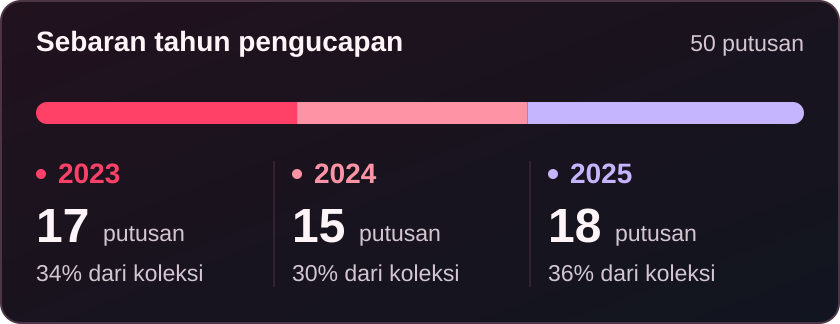

<a id="top"></a>
<p align="center">
  
</p>

<h1 align="center">Dataset Narkotika · PN Surakarta</h1>

<p align="center">
  <strong>50 putusan. Sumber yang dapat ditelusuri. Korpus untuk pencarian informasi hukum.</strong><br />
  UTS Temu Kembali Informasi · Teknik Informatika · Universitas Muhammadiyah Malang
</p>

<p align="center">
  <a href="Dataset/Narkotika.zip"><strong>Unduh 50 PDF</strong></a> &nbsp; / &nbsp;
  <a href="Overview/Overview.xlsx"><strong>Buka Overview</strong></a> &nbsp; / &nbsp;
  <a href="Verifikasi/hasil_pemeriksaan_BHT_53_putusan.json"><strong>Lihat hasil pemeriksaan</strong></a>
</p>

<p align="center"><sub>ITACHI EDITION · Bulan merah, kabut, dan Sharingan dalam animasi enam detik.<br />
<a href="assets/itachi-header.png">Lihat header tanpa animasi</a></sub></p>

---

## Tentang dataset

Repositori ini mendokumentasikan **50 putusan perkara narkotika dari Pengadilan Negeri Surakarta** yang diucapkan pada **2023–2025**. Koleksi disusun untuk Tugas 2 UTS **Temu Kembali Informasi (TKI)**: akuisisi dokumen hukum, pengelolaan metadata, dan penyusunan ringkasan barang bukti serta amar putusan.

PDF diperoleh dari [Direktori Putusan Mahkamah Agung Republik Indonesia](https://putusan3.mahkamahagung.go.id/direktori.html). Setiap dokumen dalam paket terhubung dengan satu baris Excel, URL halaman sumber, lokasi halaman amar, dan checksum SHA-256. Hubungan ini memudahkan pembaca memeriksa kembali informasi pada dokumen asal.

> **Catatan status BHT — 28 Oktober 2026**  
> Seluruh **53 halaman sumber** (50 terpilih dan 3 cadangan) berhasil dibaca. Nomor perkara, lembaga peradilan, dan klasifikasinya cocok. Skrip **tidak menemukan kolom Status** pada seluruh halaman tersebut. Temuan ini **belum membuktikan putusan non-BHT**. Persyaratan tugas terkait Berkekuatan Hukum Tetap masih perlu diverifikasi. [Laporan pemeriksaan](Verifikasi/hasil_pemeriksaan_BHT_53_putusan.json) disertakan agar hasilnya dapat ditinjau.

### Navigasi

[Ringkasan](#ringkasan-koleksi) · [Anggota](#anggota-kelompok) · [Mulai](#mulai-menggunakan) · [Struktur](#struktur-repositori) · [Skema](#skema-data) · [Metode](#akuisisi-dan-pengolahan) · [Verifikasi](#verifikasi-dan-kualitas-data) · [Katalog](#katalog-50-putusan) · [Pemanfaatan](#pemanfaatan-untuk-tki) · [Pengumpulan](#pengumpulan-tugas)

## Ringkasan koleksi

<p align="center"></p>

| Aspek | Keterangan |
| :--- | :--- |
| Lembaga peradilan | **PN Surakarta** |
| Direktori dan klasifikasi | **Pidana Khusus → Narkotika dan Psikotropika** |
| Jumlah dalam paket | **50 PDF**, 50 nomor perkara berbeda |
| Jumlah halaman | **1.712 halaman PDF** |
| Rentang tanggal pengucapan | **1 November 2023 – 25 November 2025** |
| Sebaran tahun | 2023: **17** · 2024: **15** · 2025: **18** |
| Koleksi awal | 53 PDF; 3 tetap disimpan sebagai cadangan di folder sumber |
| Bahasa dokumen | Bahasa Indonesia |
| Format | PDF, XLSX, JSON, Markdown, PNG, GIF, SVG |
| Duplikat berkas dalam paket | **0**, berdasarkan kesamaan SHA-256 |
| Tanggal pengumpulan dokumen | 28 Oktober 2026 |
| Pemeriksaan halaman sumber | 28 Oktober 2026, pukul 22:27–22:29 WIB |

Angka tahun di atas mengikuti **tanggal pengucapan putusan**, bukan tanggal unggah maupun tahun pada nama folder. Koleksi merupakan sampel tugas dari dokumen yang tersedia, bukan seluruh putusan narkotika PN Surakarta.

## Anggota kelompok

| Anggota | Nama | NIM |
| :---: | :--- | :--- |
| 01 | **Naufal Zainul Zaki** | `202310370311217` |
| 02 | **Hanisah Aufa Khalidah** | `202310370311218` |

**Mata kuliah:** Temu Kembali Informasi  
**Semester akademik:** Ganjil 2026/2027  
**Nama repositori:** `Dataset-Narkotika_217_218`

## Mulai menggunakan

1. Unduh dan ekstrak **[Dataset/Narkotika.zip](Dataset/Narkotika.zip)**.
2. Buka **[Overview/Overview.xlsx](Overview/Overview.xlsx)** dengan Excel atau aplikasi spreadsheet yang mendukung XLSX.
3. Pada sheet **Overview**, pilih nomor perkara untuk membaca barang bukti dan amar putusannya.
4. Pada sheet **Sumber dan Verifikasi**, cocokkan nama PDF, tanggal pengucapan, halaman amar, dan URL sumber.
5. Buka PDF asli untuk membaca pertimbangan lengkap atau memeriksa rincian angka dan istilah.

<details>
<summary><strong>Ekstraksi melalui PowerShell (opsional)</strong></summary>

Jalankan dari direktori utama repositori:

```powershell
Expand-Archive -LiteralPath '.\Dataset\Narkotika.zip' -DestinationPath '.\Dataset\PDF'

# Seharusnya menghasilkan 50
(Get-ChildItem -LiteralPath '.\Dataset\PDF' -Filter '*.pdf' -File).Count

# Cocokkan nilai Hash dengan kolom SHA-256 PDF pada Excel
Get-FileHash -LiteralPath '.\Dataset\PDF\01_266_Pid.Sus_2023_PN_Skt.pdf' -Algorithm SHA256
```

Nama file memakai nomor urut Excel. Apabila folder tujuan sudah berisi hasil ekstraksi sebelumnya, gunakan folder kosong untuk menghindari percampuran versi.

</details>

## Struktur repositori

```text
Dataset-Narkotika_217_218/
├── README.md
├── assets/
│   ├── itachi-header.gif            # Banner animasi, 6 detik berulang
│   ├── itachi-header.png            # Versi tanpa animasi
│   ├── itachi.png                   # Gambar referensi dari anggota
│   └── distribusi-tahun.svg
├── Dataset/
│   └── Narkotika.zip                 # 50 PDF asli
├── Overview/
│   └── Overview.xlsx                # Ringkasan dan metadata
└── Verifikasi/
    └── hasil_pemeriksaan_BHT_53_putusan.json
```

**Pola nama di dalam ZIP:** `NN_Nomor_Pid.Sus_Tahun_PN_Skt.pdf`

Contoh `01_266_Pid.Sus_2023_PN_Skt.pdf` berarti urutan **01**, perkara **266/Pid.Sus/2023/PN Skt**. Penyeragaman nama tidak mengubah isi biner PDF. Tiga dokumen cadangan tidak dimasukkan ke dalam ZIP 50 PDF.

## Skema data

### Sheet Overview

Lima kolom utama mengikuti format tugas. Satu baris mewakili satu putusan.

| Kolom | Tipe | Penjelasan |
| :--- | :--- | :--- |
| **No** | Bilangan bulat | Urutan 1–50, sama dengan awalan nama PDF. |
| **No Putusan** | Teks | Nomor perkara sebagaimana tercantum dalam PDF. |
| **Lembaga Peradilan** | Teks | PN Surakarta. |
| **Barang Bukti** | Teks | Barang bukti pada butir amar dan penetapan penggunaannya, misalnya dimusnahkan, dikembalikan, dirampas untuk negara, atau digunakan dalam perkara lain. |
| **Amar Putusan** | Teks | Seluruh butir bagian **MENGADILI**, meliputi putusan atas dakwaan, pidana, penahanan, barang bukti, serta biaya perkara. |

### Sheet Sumber dan Verifikasi

| Kolom | Penjelasan |
| :--- | :--- |
| **No** dan **No Putusan** | Kunci pencocokan dengan sheet Overview. |
| **Tanggal Putusan** | Tanggal pengucapan yang dibaca dari penutup PDF; disimpan sebagai tanggal Excel. |
| **Halaman Amar** | Nomor halaman PDF yang memuat amar, dihitung mulai dari 1. |
| **Nama PDF dalam ZIP** | Nama berkas yang harus dicocokkan setelah ekstraksi. |
| **URL Sumber dari QR PDF** | Alamat halaman detail yang diperoleh dari kode QR pada PDF. |
| **Status BHT** | Hasil pembacaan kolom status; saat ini seluruh baris berisi **Kolom status tidak ditemukan**. |
| **Catatan Sumber** | Hasil pembacaan situs dan catatan ketidakkonsistenan dokumen asli jika ada. |
| **SHA-256 PDF** | Sidik berkas untuk memeriksa integritas PDF. |

### Laporan pemeriksaan JSON

Laporan memuat **53 objek** dalam array `hasil`. Jumlah ini mencakup tiga dokumen cadangan; filter `dalam_paket_50: true` untuk memperoleh 50 putusan dalam paket.

| Field | Makna |
| :--- | :--- |
| `nomor`, `url` | Identitas perkara dan halaman yang diminta. |
| `dalam_paket_50` | Penanda apakah dokumen termasuk paket utama. |
| `waktu_periksa`, `http`, `url_akhir` | Waktu dalam UTC, kode respons, dan alamat akhir permintaan. |
| `nomor_situs`, `nomor_cocok` | Nomor yang dibaca pada halaman dan hasil pencocokannya. |
| `lembaga_situs`, `klasifikasi_situs` | Teks metadata yang dibaca dari situs. |
| `kolom_status_ditemukan`, `status_asli` | Keberadaan kolom status dan isinya jika berhasil ditemukan. |
| `hasil`, `bukti_status_html` | Kesimpulan pembacaan skrip dan potongan HTML status jika tersedia. |

`null` berarti nilai tidak diperoleh. Pada laporan ini, `status_asli: null` tidak diubah menjadi “non-BHT”. Teks klasifikasi yang berulang pada laporan mentah dipertahankan sebagaimana hasil pembacaan halaman.

## Akuisisi dan pengolahan

```text
Unduh manual dari Direktori Putusan MA
                  ↓
53 PDF awal → periksa isi, nomor perkara, tanggal, dan checksum
                  ↓
Pilih 50 tanggal pengucapan terbaru → simpan 3 sebagai cadangan
                  ↓
Ekstrak MENGADILI → barang bukti + amar → Overview.xlsx
                  ↓
Baca QR → periksa 53 halaman sumber → simpan laporan JSON
                  ↓
Kemas 50 PDF → cocokkan berkas, baris Excel, dan SHA-256
```

### Pemilihan dokumen

- Pengadilan yang dipilih: **PN Surakarta**.
- Klasifikasi: **Pidana Khusus / Narkotika dan Psikotropika**.
- Tahun yang digunakan: **2023–2025**, berdasarkan tanggal pengucapan.
- Dari koleksi awal, dipilih 50 tanggal pengucapan paling baru. Jika tanggal sama, nomor perkara lebih besar didahulukan dalam seleksi.
- Baris hasil disusun dari tanggal paling lama ke paling baru, kemudian nomor perkara.
- Pemilihan 50 dokumen tersebut **belum menyaring status BHT**.

### Ekstraksi isi

PDF diunduh manual oleh anggota kelompok. Pengolahan berikutnya membaca teks PDF dengan `pypdf` dan pola regex. Watermark, kepala/kaki halaman, serta disclaimer berulang dibuang dari **teks hasil ekstraksi**; PDF asli tetap utuh.

Amar diambil dari bagian **MENGADILI** di akhir putusan hingga sebelum penutup “Demikianlah diputuskan” atau variasinya. Barang bukti diambil dari butir amar yang menetapkan, menyatakan, atau memerintahkan penanganan barang bukti. Jarak huruf yang terpisah akibat posisi teks PDF dirapikan dengan mempertahankan substansi sumber.

Tanggal pengucapan dibedakan dari tanggal musyawarah. Ejaan bulan “Nopember” dipetakan ke November. Seluruh hasil amar ditinjau, dan contoh yang bermasalah dibandingkan dengan tampilan halaman PDF. Kode QR dibaca untuk memperoleh URL asli setiap putusan; metadata situs diperiksa melalui browser setelah pengunduhan.

## Verifikasi dan kualitas data

| Pemeriksaan | Hasil |
| :--- | :--- |
| PDF dalam arsip | **50**, seluruhnya dapat dibaca |
| Identitas perkara dalam paket | **50 nomor berbeda** |
| Integritas isi PDF | SHA-256 berkas dalam ZIP sama dengan PDF asal |
| Barang bukti dan amar | Seluruh 50 baris terisi dari bagian MENGADILI |
| URL sumber dari QR | Tersedia untuk seluruh 50 dokumen utama |
| Akses halaman sumber | **53/53 HTTP 200**, termasuk cadangan |
| Nomor perkara pada situs | **53/53 cocok** |
| Lembaga dan klasifikasi | **53/53 cocok** dengan PN Surakarta dan Narkotika dan Psikotropika |
| Kolom Status yang ditemukan skrip | **0/53** |
| Kepastian status hukum BHT | **Belum dapat ditentukan dari hasil ini** |

**Batas pemeriksaan status.** Respons HTTP 200 memastikan halaman berhasil diterima. Nomor perkara yang cocok menunjukkan skrip membaca halaman yang sesuai. Keduanya tidak memastikan status hukum perkara. Kolom Status dapat tidak ditampilkan atau memerlukan pola pembacaan lain. Uji pada halaman pembanding yang jelas berlabel BHT dan pemeriksaan bukti lanjutan masih diperlukan.

### Catatan isi yang perlu diketahui

<details>
<summary><strong>Perbedaan angka, penulisan nama, dan tanggal pada sumber asli</strong></summary>

- **312/Pid.Sus/2023/PN Skt, halaman 33:** angka denda tertulis `Rp800.000,00`, sedangkan terbilangnya “Delapan ratus juta rupiah”. Kedua bentuk dipertahankan. Nama ayah juga tertulis **MARNO** pada butir 1 dan **SUMARNO** pada butir 3.
- **327/Pid.Sus/2023/PN Skt:** penutup memuat tanggal musyawarah yang tidak konsisten. Metadata menggunakan tanggal pengucapan yang tercantum, **5 Desember 2023**.
- Pembebasan dari dakwaan primair dapat disertai pernyataan bersalah atas dakwaan subsidair. Semua butir amar tetap dimuat agar pembaca memperoleh konteks lengkap.

</details>

<details>
<summary><strong>Cakupan barang bukti, berat narkotika, dan perkara yang berkaitan</strong></summary>

- Kolom Barang Bukti mengikuti **barang bukti dalam amar**. Jika amar hanya menetapkan telepon atau kendaraan, rincian narkotika dari bagian lain tidak ditambahkan seolah tercantum pada amar.
- Berat bruto, netto, dan sisa pemeriksaan laboratorium dipertahankan sesuai uraian sumber. Nilai tersebut tidak dijumlahkan sebagai satu jenis pengukuran.
- Putusan yang berkaitan dapat menyebut barang bukti yang sama. Dua nomor perkara berbeda tidak dianggap duplikat hanya karena memiliki barang bukti atau pihak terkait yang sama.
- Kesalahan ketik pada sumber tidak dibetulkan secara substantif tanpa bukti pendukung. PDF asli tetap menjadi rujukan saat terdapat perbedaan pembacaan.

</details>

## Katalog 50 putusan

Klik nomor perkara untuk membuka halaman sumber MA. Tanggal memakai format `YYYY-MM-DD`; kolom terakhir menunjukkan **jumlah halaman dokumen**, bukan halaman amar.

<details>
<summary><strong>Buka katalog lengkap beserta 50 tautan sumber</strong></summary>

| No | Nomor putusan dan sumber | Tanggal pengucapan | Jumlah halaman |
| :---: | :--- | :---: | ---: |
| 01 | [266/Pid.Sus/2023/PN Skt](https://putusan3.mahkamahagung.go.id/direktori/putusan/zaf1bd3c450b645e866a303930333137.html) | 2023-11-01 | 20 |
| 02 | [302/Pid.Sus/2023/PN Skt](https://putusan3.mahkamahagung.go.id/direktori/putusan/zaee8f4fa0eaf686b9c8313431313036.html) | 2023-11-29 | 29 |
| 03 | [315/Pid.Sus/2023/PN Skt](https://putusan3.mahkamahagung.go.id/direktori/putusan/zaee8f4fad738e4a8713313431313237.html) | 2023-11-29 | 61 |
| 04 | [316/Pid.Sus/2023/PN Skt](https://putusan3.mahkamahagung.go.id/direktori/putusan/zaee8f4fb3d02f8282b9313431313337.html) | 2023-11-29 | 34 |
| 05 | [317/Pid.Sus/2023/PN Skt](https://putusan3.mahkamahagung.go.id/direktori/putusan/zaee8f4fbd3fe90eb56b313431313533.html) | 2023-11-29 | 38 |
| 06 | [292/Pid.Sus/2023/PN Skt](https://putusan3.mahkamahagung.go.id/direktori/putusan/zaee93d7f937a4d8a398303833373130.html) | 2023-12-05 | 43 |
| 07 | [305/Pid.Sus/2023/PN Skt](https://putusan3.mahkamahagung.go.id/direktori/putusan/zaee93d813df2a9ab13d303833373535.html) | 2023-12-05 | 26 |
| 08 | [306/Pid.Sus/2023/PN Skt](https://putusan3.mahkamahagung.go.id/direktori/putusan/zaee93d7fc16f99ca1a4303833373135.html) | 2023-12-05 | 24 |
| 09 | [308/Pid.Sus/2023/PN Skt](https://putusan3.mahkamahagung.go.id/direktori/putusan/zaee93d8117ff1269049303833373531.html) | 2023-12-05 | 39 |
| 10 | [318/Pid.Sus/2023/PN Skt](https://putusan3.mahkamahagung.go.id/direktori/putusan/zaee93d81c67ee22b1c6303833383039.html) | 2023-12-05 | 24 |
| 11 | [325/Pid.Sus/2023/PN Skt](https://putusan3.mahkamahagung.go.id/direktori/putusan/zaee93d8017d30fe8e32303833373234.html) | 2023-12-05 | 36 |
| 12 | [327/Pid.Sus/2023/PN Skt](https://putusan3.mahkamahagung.go.id/direktori/putusan/zaee93d80c0d7b6e9676303833373431.html) | 2023-12-05 | 28 |
| 13 | [294/Pid.Sus/2023/PN Skt](https://putusan3.mahkamahagung.go.id/direktori/putusan/zaee94c68e2ad53ac02c313330353030.html) | 2023-12-06 | 31 |
| 14 | [312/Pid.Sus/2023/PN Skt](https://putusan3.mahkamahagung.go.id/direktori/putusan/zaee97dbf0f54340aa10313131353339.html) | 2023-12-07 | 34 |
| 15 | [313/Pid.Sus/2023/PN Skt](https://putusan3.mahkamahagung.go.id/direktori/putusan/zaee97dbef712020ac65313131353336.html) | 2023-12-07 | 35 |
| 16 | [328/Pid.Sus/2023/PN Skt](https://putusan3.mahkamahagung.go.id/direktori/putusan/zaeea48d1f783f529757313435343132.html) | 2023-12-27 | 28 |
| 17 | [341/Pid.Sus/2023/PN Skt](https://putusan3.mahkamahagung.go.id/direktori/putusan/zaeea556f974e3c694d1313435393036.html) | 2023-12-28 | 33 |
| 18 | [186/Pid.Sus/2024/PN Skt](https://putusan3.mahkamahagung.go.id/direktori/putusan/zaf1c162940bb7aa8cec313534373335.html) | 2024-10-15 | 46 |
| 19 | [188/Pid.Sus/2024/PN Skt](https://putusan3.mahkamahagung.go.id/direktori/putusan/zaf1c1612b22ab968914313533373330.html) | 2024-10-15 | 40 |
| 20 | [203/Pid.Sus/2024/PN Skt](https://putusan3.mahkamahagung.go.id/direktori/putusan/zaf1c155ff853f509a45313431303233.html) | 2024-10-15 | 20 |
| 21 | [232/Pid.Sus/2024/PN Skt](https://putusan3.mahkamahagung.go.id/direktori/putusan/zaefc68068892dbcba1a313433333438.html) | 2024-12-30 | 43 |
| 22 | [233/Pid.Sus/2024/PN Skt](https://putusan3.mahkamahagung.go.id/direktori/putusan/zaefc7182931f8b88fa2303834303035.html) | 2024-12-30 | 37 |
| 23 | [248/Pid.Sus/2024/PN Skt](https://putusan3.mahkamahagung.go.id/direktori/putusan/zaefc71832de2ec29d5e303834303231.html) | 2024-12-30 | 40 |
| 24 | [289/Pid.Sus/2024/PN Skt](https://putusan3.mahkamahagung.go.id/direktori/putusan/zaefc71825d687b08e82303833393539.html) | 2024-12-30 | 45 |
| 25 | [290/Pid.Sus/2024/PN Skt](https://putusan3.mahkamahagung.go.id/direktori/putusan/zaefc68065ca5a60a7a3313433333433.html) | 2024-12-30 | 32 |
| 26 | [291/Pid.Sus/2024/PN Skt](https://putusan3.mahkamahagung.go.id/direktori/putusan/zaefc7183a21506a9f44303834303334.html) | 2024-12-30 | 30 |
| 27 | [305/Pid.Sus/2024/PN Skt](https://putusan3.mahkamahagung.go.id/direktori/putusan/zaefc7183073340cb0fd303834303137.html) | 2024-12-30 | 42 |
| 28 | [308/Pid.Sus/2024/PN Skt](https://putusan3.mahkamahagung.go.id/direktori/putusan/zaefc680601999149d19313433333334.html) | 2024-12-30 | 28 |
| 29 | [298/Pid.Sus/2024/PN Skt](https://putusan3.mahkamahagung.go.id/direktori/putusan/zaefc99812b70358b088313330303435.html) | 2024-12-31 | 37 |
| 30 | [299/Pid.Sus/2024/PN Skt](https://putusan3.mahkamahagung.go.id/direktori/putusan/zaefc9981009477eb8e8313330303431.html) | 2024-12-31 | 40 |
| 31 | [300/Pid.Sus/2024/PN Skt](https://putusan3.mahkamahagung.go.id/direktori/putusan/zaefc9980961d756901b313330303330.html) | 2024-12-31 | 37 |
| 32 | [307/Pid.Sus/2024/PN Skt](https://putusan3.mahkamahagung.go.id/direktori/putusan/zaefc749a8578140906a313433343234.html) | 2024-12-31 | 34 |
| 33 | [211/Pid.Sus/2025/PN Skt](https://putusan3.mahkamahagung.go.id/direktori/putusan/zaf0b3c94abe049299c3313334323337.html) | 2025-10-28 | 26 |
| 34 | [249/Pid.Sus/2025/PN Skt](https://putusan3.mahkamahagung.go.id/direktori/putusan/zaf0b9408c3f463eb68f313233383533.html) | 2025-11-04 | 19 |
| 35 | [251/Pid.Sus/2025/PN Skt](https://putusan3.mahkamahagung.go.id/direktori/putusan/zaf0ba026a01389ebc71313134363337.html) | 2025-11-04 | 37 |
| 36 | [257/Pid.Sus/2025/PN Skt](https://putusan3.mahkamahagung.go.id/direktori/putusan/zaf0bba81c53bc3cb5b9313430353135.html) | 2025-11-06 | 20 |
| 37 | [227/Pid.Sus/2025/PN Skt](https://putusan3.mahkamahagung.go.id/direktori/putusan/zaf0bedd68a62a1a84da313630343230.html) | 2025-11-11 | 21 |
| 38 | [239/Pid.Sus/2025/PN Skt](https://putusan3.mahkamahagung.go.id/direktori/putusan/zaf0becb27d26e8e9b4d313335333430.html) | 2025-11-11 | 53 |
| 39 | [240/Pid.Sus/2025/PN Skt](https://putusan3.mahkamahagung.go.id/direktori/putusan/zaf0becb26114a3e98c5313335333337.html) | 2025-11-11 | 52 |
| 40 | [258/Pid.Sus/2025/PN Skt](https://putusan3.mahkamahagung.go.id/direktori/putusan/zaf0bfaac46f91889eaf313633343230.html) | 2025-11-12 | 36 |
| 41 | [230/Pid.Sus/2025/PN Skt](https://putusan3.mahkamahagung.go.id/direktori/putusan/zaf0c0607f0bd212a3e9313431353132.html) | 2025-11-13 | 32 |
| 42 | [233/Pid.Sus/2025/PN Skt](https://putusan3.mahkamahagung.go.id/direktori/putusan/zaf0c6764949b02e8dac303830363138.html) | 2025-11-20 | 39 |
| 43 | [234/Pid.Sus/2025/PN Skt](https://putusan3.mahkamahagung.go.id/direktori/putusan/zaf0c6763a11ea2c8080303830353533.html) | 2025-11-20 | 38 |
| 44 | [235/Pid.Sus/2025/PN Skt](https://putusan3.mahkamahagung.go.id/direktori/putusan/zaf0c676446c6fec862b303830363130.html) | 2025-11-20 | 36 |
| 45 | [236/Pid.Sus/2025/PN Skt](https://putusan3.mahkamahagung.go.id/direktori/putusan/zaf0c6763e981e049b0e303830363030.html) | 2025-11-20 | 46 |
| 46 | [232/Pid.Sus/2025/PN Skt](https://putusan3.mahkamahagung.go.id/direktori/putusan/zaf0c9e28829b4c8a2a5313633383433.html) | 2025-11-25 | 29 |
| 47 | [241/Pid.Sus/2025/PN Skt](https://putusan3.mahkamahagung.go.id/direktori/putusan/zaf0c9d2d200ad1e8a30313434363135.html) | 2025-11-25 | 31 |
| 48 | [245/Pid.Sus/2025/PN Skt](https://putusan3.mahkamahagung.go.id/direktori/putusan/zaf0c9d2dc539b5a804c313434363332.html) | 2025-11-25 | 35 |
| 49 | [246/Pid.Sus/2025/PN Skt](https://putusan3.mahkamahagung.go.id/direktori/putusan/zaf0c9d2da070fa8a769313434363238.html) | 2025-11-25 | 34 |
| 50 | [275/Pid.Sus/2025/PN Skt](https://putusan3.mahkamahagung.go.id/direktori/putusan/zaf0c9d2d44fde00839f313434363139.html) | 2025-11-25 | 14 |

</details>

<details>
<summary><strong>Tiga dokumen cadangan</strong></summary>

Dokumen berikut berada di luar 50 tanggal pengucapan terbaru pada koleksi awal. PDF cadangan tetap tersimpan di folder sumber anggota kelompok dan tidak termasuk `Narkotika.zip`.

| Nomor putusan | Tanggal pengucapan |
| :--- | :---: |
| 332/Pid.Sus/2022/PN Skt | 2023-02-02 |
| 73/Pid.Sus/2023/PN Skt | 2023-06-21 |
| 280/Pid.Sus/2023/PN Skt | 2023-10-26 |

Perkara bernomor tahun **2022** pada baris pertama diucapkan pada **2023**. Ini menunjukkan pentingnya membedakan tahun nomor perkara dengan tahun pengucapan putusan. Status BHT cadangan juga belum dapat dipastikan.

</details>

## Pemanfaatan untuk TKI

Korpus dapat digunakan untuk eksperimen pencarian teks putusan, seperti pencarian jenis barang bukti, istilah dalam amar, maupun nomor perkara.

| Tahap lanjutan | Contoh penggunaan |
| :--- | :--- |
| Ekstraksi teks | Membaca seluruh halaman PDF sebagai dokumen pencarian. |
| Preprocessing | Normalisasi spasi dan huruf, tokenisasi, serta evaluasi kebutuhan stopword dan stemming. |
| Pengindeksan | Membangun indeks terbalik dengan nomor perkara sebagai identitas dokumen. |
| Pemeringkatan | Mencoba TF-IDF dengan cosine similarity atau BM25. |
| Evaluasi | Menyusun kueri dan label relevansi, lalu mengukur precision, recall, atau MAP. |

Contoh kueri: `barang bukti timbangan digital`, `narkotika golongan I bagi diri sendiri`, atau `dirampas untuk negara`.

Bagian ini menjelaskan **rencana pemanfaatan**. Paket Tugas 2 ini belum berisi mesin pencari, label relevansi, atau hasil evaluasi metode IR. Untuk tugas lanjutan yang meminta seluruh bagian putusan, gunakan teks lengkap PDF sebagai korpus; tabel Excel berfungsi sebagai metadata pendamping.

## Memperbaiki atau memperbarui data

Jika menemukan perbedaan, catat **nomor perkara, halaman PDF, teks yang bermasalah, dan bukti sumber**. Setelah repositori tersedia, catatan dapat disampaikan melalui GitHub Issues atau pull request.

Ketika mengganti dokumen:

1. Periksa pengadilan, klasifikasi, tanggal pengucapan, dan status BHT calon pengganti.
2. Perbarui kedua sheet Excel dan nama PDF agar tetap cocok.
3. Hitung SHA-256 PDF pengganti, lalu susun kembali ZIP berisi tepat 50 dokumen.
4. Perbarui katalog, statistik, dan laporan verifikasi sesuai koleksi baru.

Riwayat perubahan perlu menyebut alasan penggantian dan sumbernya. Hindari mengganti nilai yang tampak janggal hanya berdasarkan perkiraan.

## Pengumpulan tugas

- [x] Menyusun 50 PDF dan tabel lima kolom sesuai format tugas.
- [x] Menyediakan nama/NIM anggota, dokumentasi, dan sumber setiap putusan.
- [x] Memeriksa integritas berkas serta metadata 53 halaman sumber.
- [ ] Menyelesaikan verifikasi syarat tidak menggunakan putusan BHT.
- [x] Memastikan PN Surakarta tidak dipakai kelompok lain.
- [x] Membuat repositori **public** bernama **`Dataset-Narkotika_217_218`**.
- [x] Mengunggah `Dataset`, `Overview`, `Verifikasi`, `assets`, dan `README.md` ke direktori utama repositori.
- [ ] Setiap anggota mengumpulkan tautan repositori melalui LMS sesuai tenggat dosen.

Unggah **isi folder repositori** setelah mengekstrak paket pengiriman. Simpan `Narkotika.zip` tetap sebagai arsip di dalam folder `Dataset`; file tersebut berisi 50 PDF yang diminta tugas. Folder `assets` perlu ikut diunggah agar banner dan grafik README tampil.

## Sumber dan atribusi

- **Dokumen hukum:** [Direktori Putusan Mahkamah Agung RI](https://putusan3.mahkamahagung.go.id/direktori.html); tautan per perkara tersedia pada katalog dan Excel.
- **Contoh susunan dokumentasi:** [Laravel Framework](https://github.com/laravel/framework), khususnya penjelasan proyek, petunjuk penggunaan, serta panduan kontribusi yang terpisah dan mudah ditemukan.
- **Pengolahan dan dokumentasi:** Naufal Zainul Zaki dan Hanisah Aufa Khalidah.
- **Visual:** gambar Uchiha Itachi dari *Naruto* disediakan oleh anggota kelompok; banner disusun dengan bantuan imagegen, mempertahankan tata letak judul di kiri dan menempatkan ilustrasi Itachi di kanan. Lapisan kabut dibuat dengan imagegen; animasi GIF dirangkai secara lokal dengan teks tetap diam. Gambar bukan karya orisinal penyusun dataset; hak atas karakter dan gambar tetap milik pemegang hak masing-masing. Dokumentasi ini tidak menyatakan afiliasi resmi.

Dokumen sumber tetap diatribusikan kepada lembaga penerbitnya. Repositori ini tidak menetapkan lisensi perangkat lunak seperti MIT untuk keseluruhan putusan hukum. Jika mengutip dataset, sertakan nama penyusun, nama dataset, tahun penyusunan, dan URL repositori setelah diterbitkan; untuk isi putusan, sertakan nomor perkara serta URL MA.

---

<p align="center">
  <strong>Dataset-Narkotika_217_218</strong><br />
  <sub>PN Surakarta · Temu Kembali Informasi · 2026</sub><br />
  <a href="#top">Kembali ke atas</a>
</p>
